<div align="center">


# HCS Therapy Studio

**A local-first wellbeing, psychoeducation, reflection and AI-research studio.**

Chat, journal, reflect, design and evaluate — with inference on your own machine via CPU or
Vulkan. No cloud inference, no telemetry, no hidden prompt logging.

[](LICENSE)
[](MODEL_ATTRIBUTION.md)
[](#verification)
[](https://github.com/timfromhcs/hcs-therapy-studio/actions/workflows/ci.yml)
[](docs/benchmarks/m1-runtime-gate.md)
[](#privacy)
[](#honest-limitations)

[Quick start](#quick-start) · [Screens](#screens) · [Architecture](#architecture) ·
[Safety](#safety-architecture) · [Retrieval](#retrieval-honestly-labelled) ·
[Measured numbers](#measured-numbers) · [Limitations](#honest-limitations) ·
[Contributing](CONTRIBUTING.md)

</div>

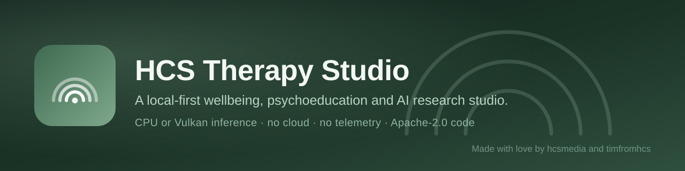

> **Made with love by hcsmedia and timfromhcs**

**See the interface:** <https://hcs-therapy-studio.vercel.app> — hosted, static, and honest
about itself. Browsers block a public page from calling `127.0.0.1`, so that build shows the
screens and says so; the actual inference runs in the desktop/CLI build on your machine.

**Status: pre-release (v0.1.0).** This README separates what is implemented, what is
experimental, and what is not built. Read [honest limitations](#honest-limitations) before
drawing any conclusion about capability. Nothing here is a medical claim.

---

## Table of contents

- [What this is (and is not)](#what-this-is-and-is-not)
- [Highlights](#highlights)
- [Screens](#screens)
- [Quick start](#quick-start)
- [What is implemented](#what-is-implemented)
- [Architecture](#architecture)
- [Safety architecture](#safety-architecture)
- [Retrieval, honestly labelled](#retrieval-honestly-labelled)
- [Measured numbers](#measured-numbers)
- [Algorithms and formulas](#algorithms-and-formulas)
- [Packages](#packages)
- [Privacy](#privacy)
- [Commands](#commands)
- [Verification](#verification)
- [Repository map](#repository-map)
- [Honest limitations](#honest-limitations)
- [Contributing](#contributing)
- [Licence and attribution](#licence-and-attribution)

---

## What this is (and is not)

It **is** a local application for supportive conversation, psychoeducation, guided
self-reflection, private journaling, a native SVG/layout studio, a model and training
laboratory, an evaluation harness with real statistics, a lexical-hybrid knowledge base over
your own notes, and a bounded local tool (MCP) layer.

It is **not** a medical device, a diagnostic tool, a therapist, or a crisis service. It does
not diagnose, does not recommend medication, and does not replace professional care. See
[`docs/safety/intended-purpose.md`](docs/safety/intended-purpose.md).

The shipped model is a general-purpose open-weight model with a scope prompt and deterministic
safety layers around it — **not** a clinically validated therapeutic model.

## Highlights

| | |
|---|---|
| **Runs offline** | `llama.cpp` sidecar, CPU always, Vulkan when the device probe passes. No CUDA requirement. |
| **Safety is code** | A deterministic crisis gate runs *before* the model. On imminent risk the model is skipped entirely. |
| **Measured, not promised** | Every performance number in this README comes from a command on a named machine. |
| **Your notes, searchable** | BM25 over words + BM25 over character trigrams, fused with reciprocal rank fusion, diversified with MMR. Citations are checked for hallucination. |
| **Statistics, not vibes** | Bootstrap confidence intervals, paired bootstrap significance tests, Bradley–Terry ranking, ECE and conformal abstention. |
| **Encrypted at rest** | Journal, messages and the knowledge index are AES-256-GCM before they touch disk. |
| **Honest about gaps** | No external benchmark score is claimed, because none was run. The README says so in three places. |

## Screens

<table>
<tr>
<td width="50%">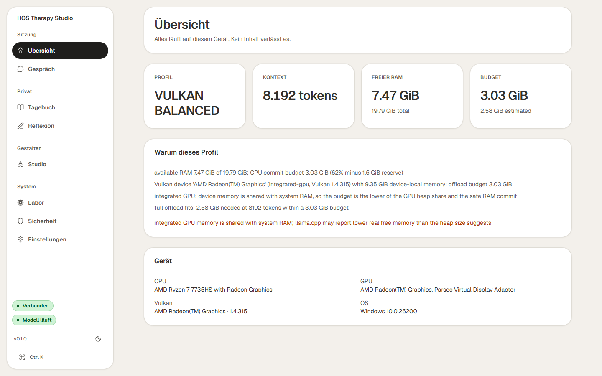<br/><sub><b>Übersicht</b> — the profile it chose, and why</sub></td>
<td width="50%">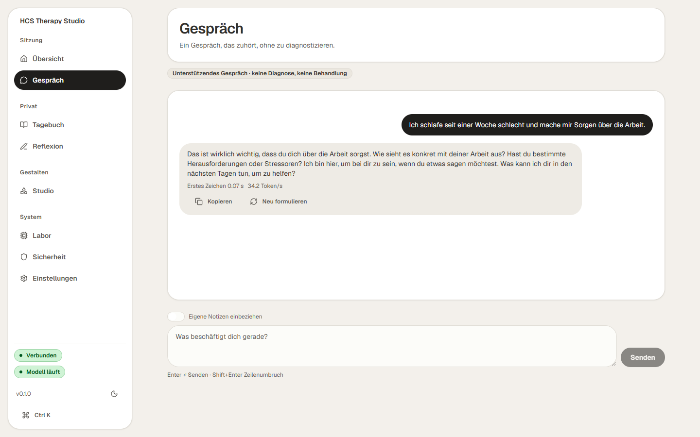<br/><sub><b>Gespräch</b> — streaming, with the measured latency in the footer</sub></td>
</tr>
<tr>
<td>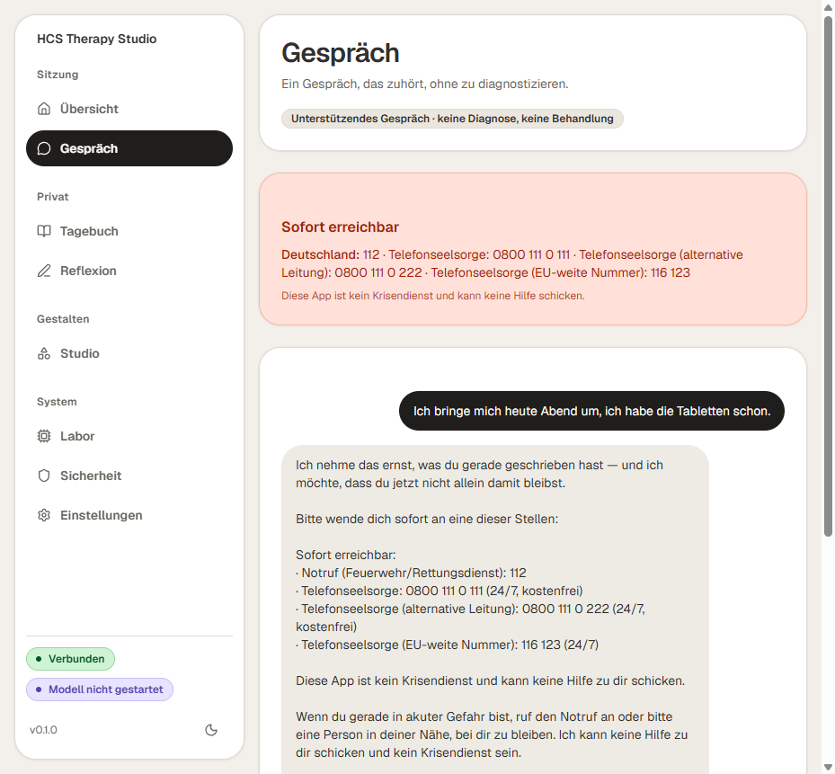<br/><sub><b>Crisis path</b> — model bypassed, verified numbers, plain text</sub></td>
<td>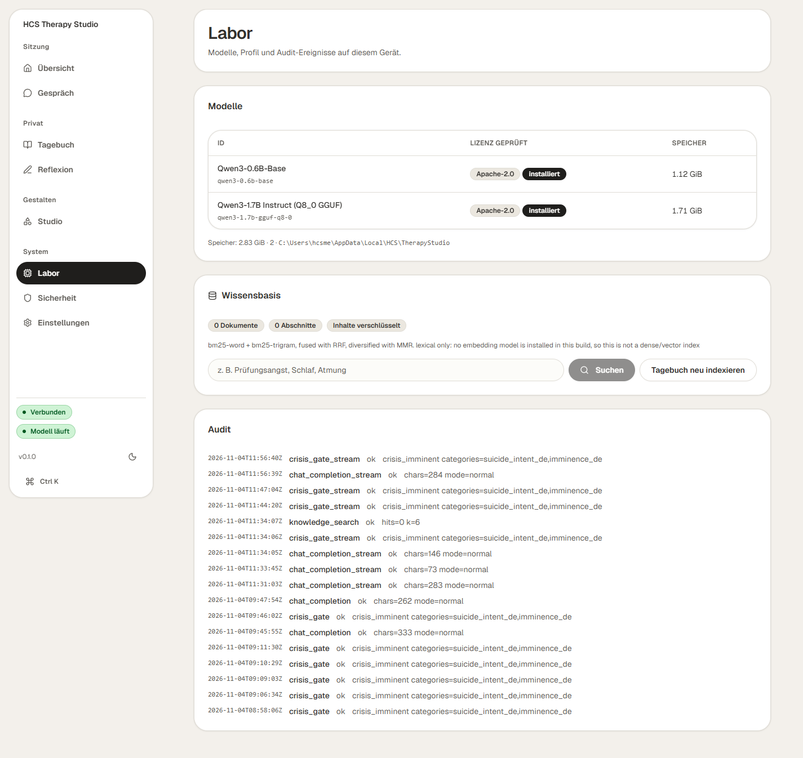<br/><sub><b>Labor</b> — models, retrieval playground, evaluation</sub></td>
</tr>
<tr>
<td>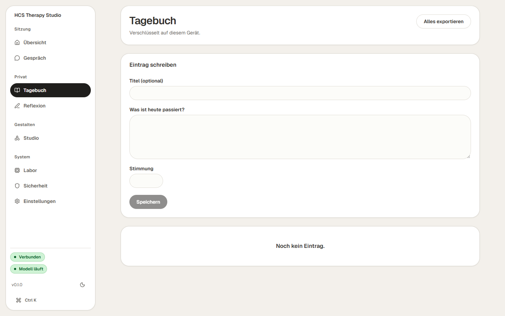<br/><sub><b>Tagebuch</b> — encrypted at rest, exportable, deletable</sub></td>
<td>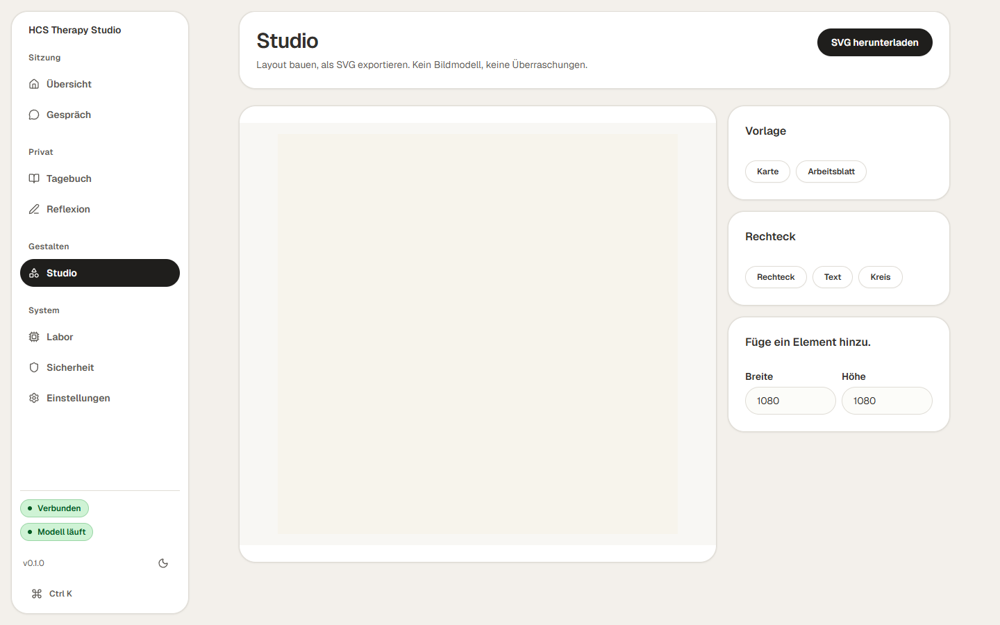<br/><sub><b>Studio</b> — SVG layers, sanitised rendering</sub></td>
</tr>
</table>

Eight screens in total: Übersicht · Gespräch · Tagebuch · Reflexion · Studio · Labor ·
Sicherheit · Einstellungen. Mobile and dark renders are in
[`docs/screenshots`](docs/screenshots).

## Quick start

Requirements: Windows 11 (primary target), Python 3.11+, 8 GB RAM minimum. Linux and macOS are
untested; nothing in the code is Windows-only except the hardware probes' fallbacks.

```powershell
git clone https://github.com/timfromhcs/hcs-therapy-studio
cd hcs-therapy-studio

uv venv --python 3.14
uv pip install -e .

.\.venv\Scripts\hcs-therapy.exe doctor          # what did it detect, and why?
```

`doctor` prints the compute profile it selected **and the reasoning behind it**:

```
OS          : Windows 10.0.26200 (AMD64)
CPU         : AMD Ryzen 7 7735HS with Radeon Graphics | 16 cores | SIMD sse2, avx, avx2
RAM         : 4.66 GiB free of 19.79 GiB
GPU         : AMD Radeon(TM) Graphics
Vulkan      : AMD Radeon(TM) Graphics (integrated-gpu, Vulkan 1.4.315, 9.35 GiB device-local)
Profile     : VULKAN_BALANCED | ctx 2048 | -1 GPU layers
```

That output is a real measurement, including the part that matters: the integrated GPU's
9.35 GiB is *shared* with system RAM, so the profile is capped by RAM that is actually free
instead of promising VRAM that does not exist.

Install the inference runtime (hash-pinned, ~36 MB) and the default text model (1.83 GB,
Apache-2.0, SHA-256 pinned):

```powershell
pwsh -File scripts/bootstrap/fetch_llama_server.ps1
.\.venv\Scripts\hcs-therapy.exe models install qwen3-1.7b-gguf-q8-0 --accept-license
.\.venv\Scripts\hcs-therapy.exe models verify  qwen3-1.7b-gguf-q8-0
.\.venv\Scripts\hcs-therapy.exe runtime smoke  --backend vulkan --json
```

Start the API *with* the model:

```powershell
.\.venv\Scripts\hcs-therapy.exe serve --port 8765 --start-backend
```

The server binds `127.0.0.1` only, prints a per-launch bearer token (**also written to
`%LOCALAPPDATA%\HCS\TherapyStudio\api-token.txt`**), and rejects any non-loopback browser
origin. Then start the UI:

```powershell
cd apps/web
npm install
npm run dev        # http://localhost:5173
```

Paste the token into **Einstellungen** and save.

### Your notes, in the loop

```powershell
# index markdown/plain-text notes you want the assistant to be able to cite
.\.venv\Scripts\hcs-therapy.exe kb index notes\*.md
.\.venv\Scripts\hcs-therapy.exe kb search "Prüfungsangst" --k 5
.\.venv\Scripts\hcs-therapy.exe kb stats --json
```

In the conversation screen, switch on **Eigene Notizen einbeziehen**. Answers then carry
`[#id]` citations, and any citation the model invents is flagged in the message.

## What is implemented

| Area | State | Evidence |
|---|---|---|
| Hardware/Vulkan detection through the real loader | implemented | `hcs-therapy doctor --json`, [`tests/test_hardware_profiles.py`](tests/test_hardware_profiles.py) |
| Single-file wheel: builds, `twine check`, installs into a clean venv, every entry point runs | implemented | `pwsh -File scripts/verify/wheel_install.ps1` |
| Compute-profile selection with explicit budgets and reasons | implemented | same |
| Resumable, hash-verified model downloads with atomic promotion | implemented | [`tests/test_manifests_downloads.py`](tests/test_manifests_downloads.py) |
| `llama-server` supervision (start, health, stop, log capture) | implemented | [`python/hcs_therapy/runtime/llama_server.py`](python/hcs_therapy/runtime/llama_server.py) |
| Loopback API: per-launch token, CORS allow-list, size caps, confirmation gate | implemented | [`tests/test_api.py`](tests/test_api.py) |
| Server-sent-events streaming chat with TTFT and tok/s | implemented | [`tests/test_streaming.py`](tests/test_streaming.py) |
| Deterministic crisis gate (EN/DE), negation, third person, quoted, injection | implemented | [`tests/test_crisis.py`](tests/test_crisis.py) |
| Multi-turn crisis trajectories, incl. session-level attentiveness | implemented, **6/6** | [`docs/safety/crisis-trajectories.md`](docs/safety/crisis-trajectories.md) |
| Verified regional resource pack with source and review date | implemented | [`tests/test_policy.py`](tests/test_policy.py) |
| Output guard: diagnosis, medication, false certainty, dependence, invented hotlines | implemented | same |
| Region and language of the crisis message match the UI | implemented | [`tests/test_region_consistency.py`](tests/test_region_consistency.py) |
| Encrypted-at-rest journal, messages **and knowledge index** (AES-256-GCM) | implemented | [`tests/test_storage.py`](tests/test_storage.py) |
| Lexical-hybrid knowledge base: BM25 + trigram BM25 + RRF + MMR, citations | implemented | [`tests/test_knowledge.py`](tests/test_knowledge.py) |
| Hallucinated-citation detection | implemented | [`tests/test_knowledge.py`](tests/test_knowledge.py) |
| German address-register anchoring (`du`/`Sie`) and mixing detection | implemented, **measured 0/15 vs 6/15** | [`docs/benchmarks/register-anchoring.md`](docs/benchmarks/register-anchoring.md) |
| Tool registry: JSON-Schema validation, policy gate, budgets, audit | implemented | [`tests/test_agent_mcp.py`](tests/test_agent_mcp.py) |
| MCP server over stdio (JSON-RPC 2.0) | implemented | same |
| Dataset gating: provenance, PII, dedup, review status, train/eval leakage | implemented | [`tests/test_datasets.py`](tests/test_datasets.py) |
| Evaluation harness with CIs, paired significance and ranking | implemented | [`tests/test_evals_stats.py`](tests/test_evals_stats.py) |
| Numerics library: BM25, RRF, MMR, samplers, calibration, conformal, BT, TIES, DPO family | implemented | [`tests/test_numerics_*.py`](tests) (216 tests) |
| TypeScript SDK: builds with declarations, packs to a tarball, browser-safe | implemented | [`tests/test_sdk_package.py`](tests/test_sdk_package.py) |
| CPU LoRA training pipeline with memory gate, checkpoints, resume | *pipeline* proven, not a quality result | [`status.md` §M4](status.md) |
| SVG sanitiser + constrained scene renderer | implemented | [`tests/test_svg.py`](tests/test_svg.py) |
| Attribution/SBOM generation from manifests | implemented | `hcs-therapy license generate` |

## Architecture

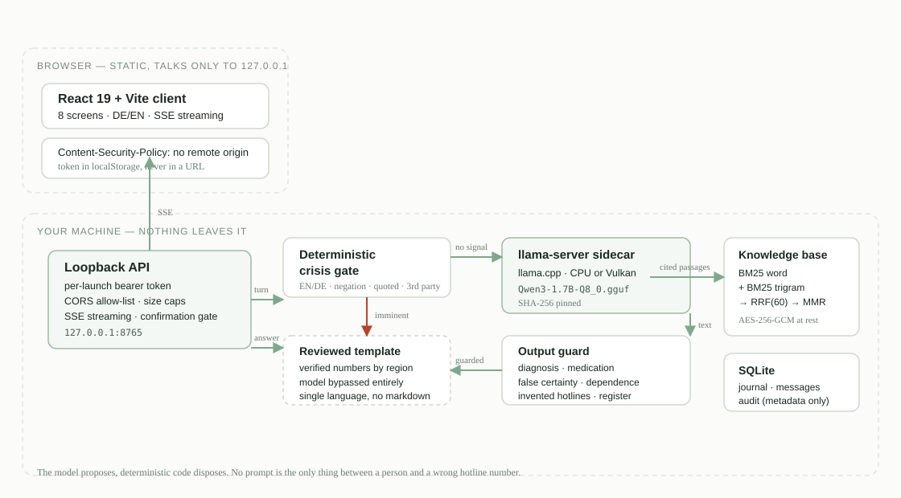

The layering rule: **the model proposes, deterministic code disposes.** No prompt text is
allowed to be the only thing standing between a user and a wrong hotline number.

Every component in that diagram is a real process or module in this repository, not a plan:
the token is generated per launch in [`runtime/api.py`](python/hcs_therapy/runtime/api.py), the
CSP is in [`apps/web/index.html`](apps/web/index.html), and the sidecar is supervised in
[`runtime/llama_server.py`](python/hcs_therapy/runtime/llama_server.py).

## Safety architecture

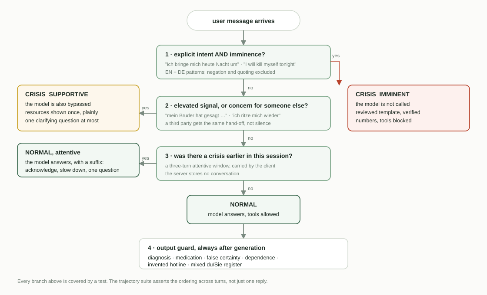

A system prompt is not safety. The layers that actually run:

1. **Deterministic crisis gate before the model is called.** On an imminent signal the model is
   *skipped entirely*; the response is a reviewed template with verified numbers for the user's
   region. The streaming endpoint opens the SSE response only after the gate decides.
2. **Session memory across turns.** A hand-off marks the next three turns *attentive*: a
   `system_suffix` tells the model to acknowledge, slow down and ask one plain question instead
   of returning to small talk. Six multi-turn trajectories assert the ordering
   ([`docs/safety/crisis-trajectories.md`](docs/safety/crisis-trajectories.md)).
3. **Verified resource pack** with a source URL and review date per entry, plus an explicit
   "no verified pack" fallback that never invents a hotline.
4. **Single-language guarantee.** A German answer containing an English line reads as a broken
   template. The region *and* the language of the crisis message come from the same validated
   source as the crisis card.
5. **Output guard** that flags diagnostic claims, medication advice, false certainty,
   dependence-fostering language and unrecognised service numbers, and replaces the text.
6. **Tool budget gate** that requires approval for side effects and cannot be talked around by
   the model.
7. **Tests for all of the above**, including negation, third-person concern, quoted fiction,
   prompt injection and multilingual input.

The attentive window is held **client-side**: the server does not store a conversation to
remember it, so a restart cannot resurrect a session it should not have.

## Retrieval, honestly labelled

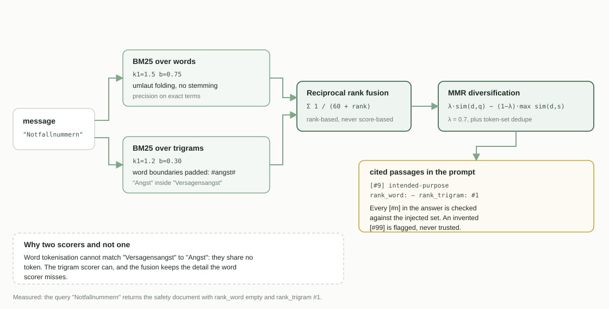

There is no embedding model in this build, so this is **not** a vector database and is never
described as one. What it is:

1. **BM25 over words** (`k1=1.5, b=0.75`) — precision on exact terms.
2. **BM25 over character trigrams** (`k1=1.2, b=0.3`) — what makes "Versagensangst" match
   "Angst", which word tokenisation cannot do.
3. **Reciprocal rank fusion**, `k = 60` (Cormack, Clarke & Büttcher 2009) — fuses ranks, never
   scores, because the two scorers are not on a comparable scale.
4. **Maximal marginal relevance**, `λ = 0.7` (Carbonell & Goldstein 1998) — turns ten
   near-identical hits into five useful passages.

Chunk text is encrypted with the same AES-256-GCM key as the journal. An index stored in
plaintext beside an encrypted journal would quietly undo the encryption, so there is a test
for exactly that.

## Measured numbers

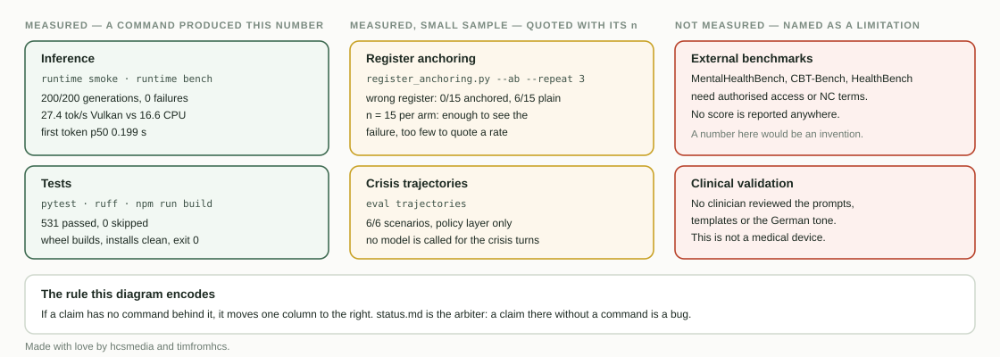

Everything below was executed on **AMD Ryzen 7 7735HS, Radeon 680M (integrated), 19.79 GiB
RAM, Windows 11 26200**, with `Qwen3-1.7B-Q8_0.gguf` (sha256 `061b54da…cb1a`) and `llama.cpp`
b12102.

| Check | CPU | Vulkan |
|---|---|---|
| 100 repeated generations | 100/100, **0 failures** | 100/100, **0 failures** |
| Throughput | 16.55 tok/s | **27.36 tok/s** (1.65×) |
| Latency p50 (48 tokens) | 2,823 ms | 1,722 ms |
| Server working set | 1.86 GiB | 2.70 GiB |
| Single-shot load | 3.18 s | 6.07 s |

Time-to-first-token, measured on the streaming path (`runtime bench --stream`, 5 requests):

| Metric | Vulkan |
|---|---|
| First token, p50 | **0.199 s** |
| First token, p95 | 0.669 s |
| Mean throughput | 28.17 tok/s |
| Failed requests | 0 / 5 |

End-to-end in the browser against the production bundle: **0.12 s** to the first visible
character, 33.1 tok/s, rendered in the message footer.

### German address register

`status.md` recorded from M1 onwards that the model mixed `du` and `Sie` inside one answer. The
reply is now anchored to the register the person actually used, and the result is measured
rather than asserted (`scripts/bench/register_anchoring.py --ab --repeat 3`):

| Arm | n | mixed `du`/`Sie` | wrong register |
|---|---|---|---|
| anchored (shipped) | 15 | 0 | **0** |
| unanchored | 15 | 0 | **6** |

Without the anchor the model answers every German prompt in `du`, including the four whose
prompt used `Sie`. Full method, failure samples and the n=15 caveat:
[`docs/benchmarks/register-anchoring.md`](docs/benchmarks/register-anchoring.md).

> `Qwen3` reasons before it answers. With its reasoning phase enabled, the first *visible*
> token arrived after **13.3 s** — measured, not estimated. The studio therefore disables the
> reasoning phase for conversation (`chat_template_kwargs.enable_thinking = false`), which is
> what takes 13.3 s down to 0.12 s. The scratchpad is not shown to the user either way.

Full reports: [`docs/benchmarks/m1-runtime-gate.md`](docs/benchmarks/m1-runtime-gate.md).

## Algorithms and formulas

`hcs_therapy.numerics` implements the published formulas the project reasons with, each tested
against an analytically known value rather than against itself.

| Module | Contents | Anchor test |
|---|---|---|
| `retrieval.py` | BM25, RRF (k=60), MMR (λ), trigram tokeniser, dedup | BM25 score recomputed by hand from the formula |
| `sampling.py` | temperature, top-k, top-p, min-p, typical, repetition/frequency/presence, DRY | uniform distribution ⇒ perplexity = \|V\| exactly |
| `calibration.py` | ECE (equal-mass bins), Brier, NLL, temperature scaling, Platt scaling, split conformal | conformal coverage ≥ 1−α on 2000 synthetic draws |
| `rating.py` | Bradley–Terry (MM algorithm), Elo, percentile bootstrap, paired bootstrap | BT recovers a planted 2:1 strength ratio |
| `metrics.py` | Cohen κ, Fleiss κ, macro-F1, MRR, NDCG@k, pass@k | pass@5 = 1 − C(8,5)/C(10,5) exactly |
| `quant.py` | GGUF block sizes (Q2_K…Q8_K), KV bytes/token, LoRA parameter count, DoRA | bits-per-weight match `ggml-quants.h` struct sizes |
| `merge.py` | SLERP, TIES-Merging, DARE, task vectors | SLERP at t∈{0,1} is the exact endpoint |
| `alignment.py` | DPO, IPO, ORPO, SimPO, CPO losses, GRPO advantage | DPO at equal log-ratios = log 2 |

Two of these are wired into the product, not just available: the retrieval stack powers the
knowledge base, and the calibration/rating stack powers `eval compare` and `eval rank`, where a
dimension delta now carries a **paired** bootstrap p-value instead of being eyeballed.

## Packages

| Artifact | State | How it was checked |
|---|---|---|
| `hcs-therapy-core` (Python wheel) | builds, installs clean | `pwsh -File scripts/verify/wheel_install.ps1` → exit 0 |
| `@hcsmedia/therapy-sdk` (npm) | builds, packs | `npm pack --dry-run` → 14 files, 10.2 kB |
| Hosted interface (Vercel) | live, interface only | <https://hcs-therapy-studio.vercel.app> — HTTP 200, no third-party origin in `performance.getEntriesByType('resource')` |
| Desktop `.exe` installer | **not built** | — |
| Browser WebGPU edition | **not built** | — |

The TypeScript client is browser-safe by test: no `node:` import, no `require(`, no `Buffer.`,
no runtime dependency, and every mutating method sends an explicit `confirmed: true` that the
server enforces.

```ts
import { createClient } from "@hcsmedia/therapy-sdk"

const studio = createClient({ token: process.env.HCS_TOKEN! })
await studio.chatStream(
  { messages: [{ role: "user", content: "Ich schlafe schlecht." }] },
  { onDelta: (d) => process.stdout.write(d) },
)
```

Nothing has been published to a registry. See [honest limitations](#honest-limitations).

## Privacy

- No analytics, no crash telemetry, no prompt logging, no third-party fonts or scripts.
- Journal, messages **and knowledge chunks** are AES-256-GCM before they reach SQLite. The key
  lives beside the database; back it up — losing it means losing the entries, and that
  limitation is stated in the UI.
- Audit rows contain metadata only (event, tool, status, byte counts).
- The local API only listens on `127.0.0.1`, requires a token generated per launch, and the
  static client carries a Content-Security-Policy that forbids remote origins.
- Full data-flow description: [`docs/privacy/data-flow.md`](docs/privacy/data-flow.md).

## Commands

```powershell
hcs-therapy doctor [--json] [--no-vulkan] [--probe]
hcs-therapy models list|verify|install|remove
hcs-therapy runtime status|smoke|bench [--backend auto|cpu|vulkan] [--n 5]
hcs-therapy serve [--port 8765] [--model ID] [--start-backend] [--no-encrypt]
hcs-therapy kb stats|search|index
hcs-therapy eval run --suite hcs-core [--provider echo|local]
hcs-therapy eval compare --baseline a.json --candidate b.json
hcs-therapy eval rank --reports a.json b.json c.json
hcs-therapy eval calibrate --report r.json
hcs-therapy eval trajectories [--json]
hcs-therapy data validate|scan|leakage
hcs-therapy safety assess "text" | scan "text" | resources
hcs-therapy license verify | generate
hcs-therapy svg sanitize FILE | render SCENE.json
hcs-therapy agent tools | call TOOL --args '{...}' | audit
```

## Verification

```powershell
.\.venv\Scripts\python.exe -m pytest        # 539 passed
.\.venv\Scripts\python.exe -m ruff check .  # all checks passed
cd apps/web; npm run build                  # tsc -b && vite build
pwsh -File scripts/verify/wheel_install.ps1 # build, twine check, clean-venv install, entry points
cd packages/sdk-ts; npm pack --dry-run      # 14 files, no sources, no dependencies
```

CI runs the same commands on `windows-latest` and `ubuntu-latest`, plus the TypeScript build and
a link check. The torch-dependent numerics get their own job, because only one file needs torch
and installing it on every matrix leg would triple the runtime for 47 tests: 492 + 47 = 539, and
the split is in [`.github/workflows/ci.yml`](.github/workflows/ci.yml) rather than hidden.

The web client was checked in Chromium against the production bundle: all eight screens at
375, 768 and 1440 px, zero console errors, zero horizontal overflow, real streaming, real crisis
path, real knowledge search. Screenshots live in [`docs/screenshots`](docs/screenshots).

[`status.md`](status.md) is the record of what was executed, with commands. If a claim there has
no command, the claim is wrong and should be removed.

## Repository map

```
python/hcs_therapy/     runtime package
  numerics/             BM25 · RRF · MMR · samplers · calibration · conformal · BT · TIES · DPO
  safety/               crisis gate, policy, verified resources, output guard, register
  runtime/              loopback API (SSE streaming), llama-server supervision
  agent/                tool registry, policy gate, MCP stdio server
  knowledge.py          chunking, encrypted index, hybrid retrieval, citations
  evals.py              suites, CIs, paired significance, ranking, calibration
  hardware.py profiles.py models/ storage.py train.py svg.py datasets.py licensing.py
packages/sdk-ts/        @hcsmedia/therapy-sdk — typed client, browser-safe, zero deps
tests/                  539 pytest tests
apps/web/               React 19 + Vite client (8 screens, DE/EN, SSE streaming)
assets/                 logo, banner and diagrams (authored in-repo, no remote resources)
docs/                   architecture, ADRs, safety, privacy, benchmarks, screenshots
models/manifests/       pinned model manifests (GGUF + training base)
licenses/manifest.yaml  licence register with verified upstream revisions
```

## Honest limitations

- **No external benchmark score is reported anywhere.** MentalHealthBench, CBT-Bench and
  HealthBench need authorised access or non-commercial terms and are not bundled. The local
  suite measures behaviour on this project's own prompts only.
- **Inference works and is measured; quality is not established.** The German register problem
  is addressed and measured (0 of 15 anchored replies broke the anchor), but that is register
  compliance on 15 prompts — not quality, empathy or accuracy. The register study is n=15 per
  arm, which is enough to see a 6-of-15 failure disappear and not enough to quote a rate.
- **Retrieval is lexical.** A paraphrased question with no shared words or trigrams returns
  nothing, and the response says so rather than pretending. Adding an embedding model is future
  work, not a hidden feature.
- **The default model is Q8_0** because that is the only quantisation Qwen publishes officially.
  Q4_K_M would need a separately audited third-party repo.
- **The integrated GPU shares memory with the system.** Free-RAM measurement drives the
  profile, so the same machine reports different context sizes at different times. That is
  honest, not unstable.
- **No deterministic rule set catches every crisis signal.** The gate is conservative in both
  directions and is not a substitute for human care.
- **German text quality is untested against native reviewers.** A reviewer pass is a human task
  and is listed as outstanding.
- **The training pipeline is not a quality result.** It ran for real on a 0.6B base with 10
  steps; the corpus is 10 `engineering-smoke` rows and the run is marked `promotable: false`.
  The 1.7B run is refused by the memory guard on this machine, correctly.

**Not built yet:**

| Missing | Why it is not claimed |
|---|---|
| Windows one-file installer | Not packaged. Running from source is the supported path. |
| WebGPU / WASM browser edition | No model has been compiled or benchmarked for a browser runtime. |
| Inference from the hosted page | **Measured**: a `fetch` from a public HTTPS page to `http://127.0.0.1:8765` never settles in Chromium — browsers restrict public pages talking to loopback. The hosted build therefore shows the interface and says so, instead of promising a connection it cannot make. |
| VLM runtime | No vision model has been proven on this hardware. |
| Text-to-image | Licence chain not approved; see [ADR-005](docs/decisions/ADR-0005-image-generation.md). |
| Registry publication | The wheel and the npm tarball build locally and install cleanly. Nothing was uploaded to PyPI or npm. |
| Clinician review | A human task. No reviewer has seen these prompts. |

## Contributing

Read [`CONTRIBUTING.md`](CONTRIBUTING.md) and [`AGENTS.md`](AGENTS.md). The short version: no
fabricated capability, no placeholder UI, no test that is skipped and still described as
passing, and no model or dataset without a licence record.

Security issues: see [`SECURITY.md`](SECURITY.md).

## Licence and attribution

Application code is **Apache-2.0** ([`LICENSE`](LICENSE)). **Model weights are not covered by
that licence** — each has its own terms, recorded in
[`licenses/manifest.yaml`](licenses/manifest.yaml) and
[`MODEL_ATTRIBUTION.md`](MODEL_ATTRIBUTION.md). Dataset terms are in
[`DATASET_ATTRIBUTION.md`](DATASET_ATTRIBUTION.md). Third-party notices:
[`THIRD_PARTY_NOTICES.md`](THIRD_PARTY_NOTICES.md). SBOM: [`SBOM.spdx.json`](SBOM.spdx.json).

Upstream projects and model providers do not endorse this application.

---

<div align="center">

**HCS Therapy Studio** · Made with love by [hcsmedia](https://github.com/hcsmedia) and timfromhcs

If you build on this, keep the limitations section honest. That is the point of it.

</div>
